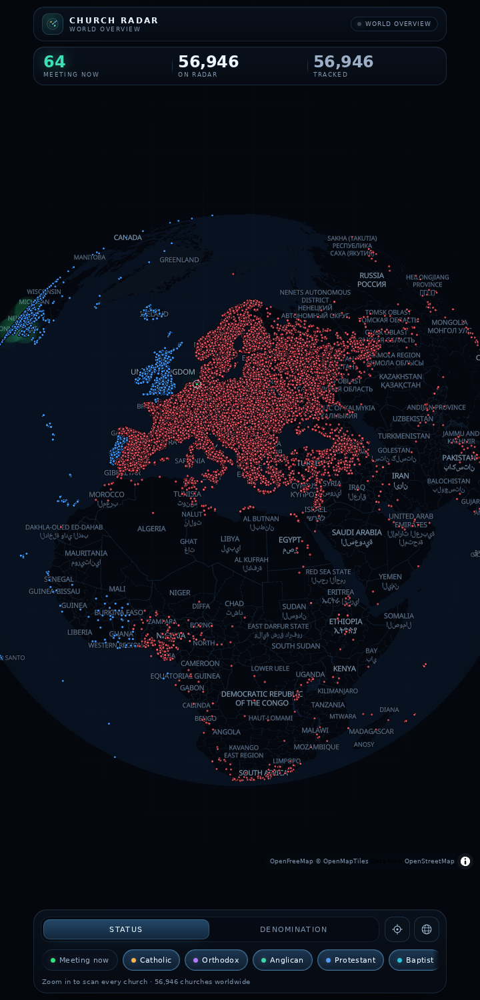
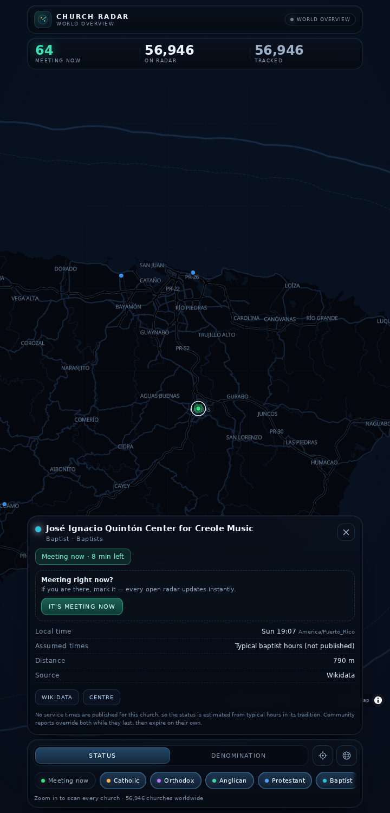
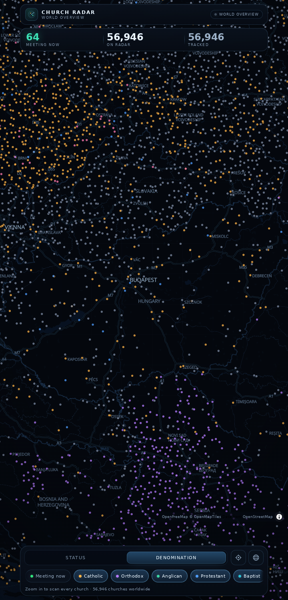

# Church Radar

A world radar of **real churches**, rendered as coloured dots on a globe.

- **Status mode** — **green** when the church is meeting *right now* (live dots pulse),
  **blue** when it already met earlier today, **red** when it is not meeting (yet).
- **Community check-ins** — someone at a church taps *It's meeting now* and every open radar marks
  it live instantly, ringed in white. Others can confirm while it lasts.
- **Denomination mode** — the same dots coloured by tradition (Catholic, Orthodox, Anglican,
  Protestant, Baptist, Evangelical/Pentecostal, Adventist, Restorationist, other).

Pan and zoom; when you are zoomed in far enough the radar scans OpenStreetMap for every church in
view. Statuses re-evaluate every 15 seconds against each church's **own time zone**, and the scan
refreshes every 5 minutes.

Android-first: the same build is an installable Android app (Capacitor shell in `android/`, package
`app.churchradar.mobile`) and a standalone PWA (offline shell, safe-area aware, touch sized).

## Install

| Where | How |
| --- | --- |
| **GitHub** | [Latest release](https://github.com/CrossbowCraft13/ChurchRadar/releases/latest) → download `ChurchRadar-1.0.0.apk`, open it on the phone, allow installing from unknown sources |
| **Orion Store** | Submitted from this repo; the catalogue entry is ready in [`store/orion-entry.json`](store/orion-entry.json). Once it is listed, search *Church Radar* in [Orion](https://orionstore.net) |

Android 6.0 (API 23) or newer, about 5 MB, and an internet connection (churches, tiles and check-ins
are live). It is not on Google Play. Every build is release-signed with the project keystore and ships
beside a `.sha256` file:

```bash
sha256sum -c ChurchRadar-1.0.0.apk.sha256
```

| World | A church meeting now | By denomination |
| --- | --- | --- |
|  |  |  |

## Where the data comes from

| Layer | Source | Notes |
| --- | --- | --- |
| Live churches in view | [OpenStreetMap](https://www.openstreetmap.org) via the public [Overpass API](https://wiki.openstreetmap.org/wiki/Overpass_API) (`amenity=place_of_worship`, `religion=christian`), ways and relations included | Mirrors are tried in order: `overpass.openstreetmap.fr`, `overpass-api.de`, `overpass.kumi.systems`, `overpass.private.coffee` |
| World overview (zoomed out) | Bundled snapshot of every Wikidata church building, cathedral and basilica with coordinates — 272,848 items, thinned to one per 0.1° cell so 56,946 churches ship, CC0 | `public/data/world-churches.json`, regenerated with `npm run seed` |
| Basemap | [OpenFreeMap](https://openfreemap.org) dark vector tiles, re-tinted into the radar palette | `public/style.json`, regenerated with `python3 scripts/make_style.py` |

Nothing needs an API key or an account.

### How "meeting now" is computed

1. **Published schedule** — if a church has OSM `service_times` (e.g.
   `Su 09:00,10:00; Sa 18:00`), those slots are parsed and evaluated in the church's local time zone.
   The detail sheet marks these as *Service times*.
2. **Estimated schedule** — churches without published times fall back to typical hours for their
   tradition (Sunday morning, Saturday vigil for Catholic, Saturday for Adventist, …). The sheet says
   *Assumed times* and the note explains it, so an estimate is never presented as a fact.

Local time comes from an offline coordinate → IANA time-zone lookup, so a church in Nairobi is
evaluated on EAT even when you are in Berlin.

Dot colours in status mode:

| Colour | Meaning | When |
| --- | --- | --- |
| green | meeting now | inside a service window, or a live community check-in |
| blue | met today | a service ended earlier today and none is running |
| red | not meeting | nothing has run yet today — including before the first service |

At continental zoom only every fourth dot is drawn (a stable per-church tier), so 57k churches read
as a stipple instead of a solid carpet; zoom in and every church appears.

## Community check-ins

Published and estimated times are guesses. A person standing in the building is not. Tap **It's
meeting now** in a church's sheet and:

1. the report is written durably to D1 (`worker/index.js`), then
2. broadcast over the platform realtime room `church-radar:checkins`, so every open radar — in any
   browser or installed app — flips that dot to live and counts it in *Meeting now* within
   milliseconds. A white ring marks community-confirmed dots so they are never confused with a
   published schedule.
3. other visitors can tap **Still meeting** to confirm; the reporter count grows, repeats from the
   same person do not.

A report lasts 90 minutes (`CHECKIN_TTL_SECONDS` overrides that), extends while people keep
confirming, and expires on its own. The app also reloads a snapshot every 30 seconds and whenever it
comes back to the foreground, so a missed broadcast can never leave a radar permanently stale.

**Trust model.** Visitors get an opaque server-issued, HMAC-signed `HttpOnly` cookie; the browser
never chooses an id, realtime tickets are always minted with `publish: false`, and check-in writes
require a same-origin request with a JSON body (the request's own origin, the configured app origin,
or loopback in development). Posts are rate limited per network (30/hour) and deduplicated per
visitor per church. Nothing about a visitor is displayed or stored beyond a hashed voter id and the
report itself.

Hosted without the Worker (for example `dist/` on a plain static host) the radar behaves exactly as
before and the sheet reports that community check-ins are offline.

| Route | Purpose |
| --- | --- |
| `GET /api/checkins` | durable snapshot of every active check-in |
| `POST /api/checkins` | `{ churchId }` — report or confirm a gathering |
| `POST /api/realtime/ticket` | single-use realtime ticket, `publish: false` |
| `GET /api/health` | readiness probe (database + realtime bindings) |

## Run it

```bash
npm install
npm run dev        # http://localhost:3000
npm run build      # type-check + production build into dist/
npm run test       # unit tests: schedule parsing, denomination mapping, check-in merging
```

Open it on Android Chrome and use *Add to home screen* for the standalone experience.

To work on community check-ins locally, run the realtime hub, the check-in Worker (which also serves
`dist/`), and the dev app in three shells. The dev server proxies `/api` to the Worker, so cookies
and tickets stay same-origin:

```bash
npm run checkins:helper   # realtime hub in workerd, ws://127.0.0.1:8788
npm run checkins:worker   # check-in Worker on http://127.0.0.1:8787 (run `npm run build` first)
npm run dev               # app on http://localhost:3000
```

### Verify it end to end

Both scripts start and stop their own servers, so stop any dev server on ports 3000, 8787 or 8788
first.

```bash
npm run verify:checkins   # two websocket clients: instant fan-out, dedupe, guards, expiry
npm run verify:ui         # two independent browsers: check in on one, watch the other update
```

The UI script drives Playwright's Chromium (`npx playwright install chromium`); set `CHROME_PATH`
(and `CHROME_LIBS` for a library path) to point it at another build, and it leaves screenshots in
`artifacts/`.

To run the same two-browser check against a deployment — the real D1 database and the managed
realtime hub instead of the local helpers — point it at the site and skip the local servers:

```bash
BASE_URL=https://your-site.freebuff.page SHOT_PREFIX=hosted node scripts/verify-ui.mjs
```

## Android app (Capacitor)

The PWA is the app; Capacitor wraps it in a native shell (`android/`, app id
`app.churchradar.mobile`) so it installs from an APK or the Play Store.

```bash
npm run android:add     # once: builds the web app and scaffolds android/
npm run android:sync    # after each change: rebuild dist and copy it in
npm run android:apk     # build android/app/build/outputs/apk/debug/app-debug.apk
npm run android:open    # opens Android Studio to run on a device / build an AAB
```

Building needs a **JDK 21** and Android SDK platform **35** + build-tools 35 (Capacitor 7's Android
library compiles at Java 21; a JDK 17 fails with `invalid source release: 21`). Neither ships in this
repo. Point Gradle at them with `JAVA_HOME` / `ANDROID_HOME`, then run `npm run android:apk`.

The shell loads the **published app origin** (`server.url` in `capacitor.config.ts`, overridable with
`CHURCH_RADAR_ORIGIN`) rather than the bundled `dist/` files. Check-ins and the realtime socket are
first-party-cookie, same-origin features, and a bundled copy would run on `https://localhost` where
the Worker's origin gate rejects it — so the wrapper loads the real site and the app behaves exactly
like the web build. `public/connection.html` is the bundled fallback screen when the site cannot be
reached. The `dist/` snapshot is still packaged, so the icon, splash and fallback work offline.

### Signing

Release builds are signed with `android/church-radar-release.jks`, unlocked by `android/keystore.properties`.
Both files are git-ignored and **must be backed up**: Android only installs an update over an existing
app when the signature matches, so losing this key means every future version has to be a fresh install
on a new package name.

- Key alias `churchradar`, RSA 4096, valid 30 years, certificate
  `E6:59:2A:DD:6F:2B:EE:FD:0B:ED:FF:22:B8:ED:8C:72:56:B1:53:C9:74:46:1A:8E:88:B4:AB:6C:F5:B9:E8:45`.
- To let GitHub Actions sign releases, add the key and its passwords as repository secrets — see the
  header of `.github/workflows/release-apk.yml`:
  `base64 -w0 android/church-radar-release.jks` → `ANDROID_KEYSTORE_BASE64`, plus
  `ANDROID_KEYSTORE_PASSWORD`, `ANDROID_KEY_ALIAS` and `ANDROID_KEY_PASSWORD`.
- Without `keystore.properties` the release build falls back to the debug key, so a fresh clone still
  builds; never publish an APK built that way.

### Publish a release

Bumping the version and pushing a tag is the whole release — the workflow builds the signed APK,
checksums it and attaches it to the tag, which is exactly where Orion Store looks.

1. Set `versionCode` and `versionName` in `android/app/build.gradle`.
2. Add `fastlane/metadata/android/en-US/changelogs/<versionCode>.txt` and update
   [`CHANGELOG.md`](CHANGELOG.md).
3. `git tag v1.0.0 && git push origin v1.0.0`.

To publish by hand instead:

```bash
npm run android:release     # android/app/build/outputs/apk/release/app-release.apk
cp android/app/build/outputs/apk/release/app-release.apk artifacts/ChurchRadar-1.0.0.apk
sha256sum artifacts/ChurchRadar-1.0.0.apk > artifacts/ChurchRadar-1.0.0.apk.sha256
```

Then attach the APK and its `.sha256` to a GitHub release tagged `v1.0.0`, and submit the repository in
Orion Store (`store/orion-entry.json`; `releaseKeyword: "apk"` tells Orion which asset to serve). The
store icon, screenshots and copy live in `fastlane/metadata/android/en-US/` — regenerate the shots with
`npm run store:shots` after a visual change.

## Deploy

`deploy.json` publishes the built app and the check-in Worker as one Sites project: static assets
from `dist/`, API routes from `worker/index.js`, `realtime: true` for the managed room hub. The
Worker needs a D1 database bound as `DB`; realtime and the application origin are injected by the
platform (`APP_ORIGIN`). Nothing else needs a key or an account.

## Project layout

```
src/
  App.tsx                 state: colour mode, filters, scanning, selection, check-ins
  components/
    RadarMap.tsx          MapLibre globe, dot/glow/pulse/community-ring layers, labels, taps
    Hud.tsx               counts + sync state
    Dock.tsx              mode switch, denomination chips, legend
    ChurchSheet.tsx       church detail card + community check-in
  lib/
    denomination.ts       raw OSM/Wikidata values → 9 filterable families + colours
    schedule.ts           service_times parser, estimated hours, status evaluation
    time.ts               coordinate → time zone, local clock, memoised
    overpass.ts           bbox query, mirror failover, caching
    church.ts             shared Church model and source adapters
    checkins.ts           check-in model, snapshot merge, expiry, API client
    realtime.ts           typed room client (ticket → websocket → renewal → backoff)
    cache.ts              IndexedDB cache with in-memory fallback
    seed.ts               bundled world overview loader
worker/
  index.js                check-in API + static asset worker (D1, realtime fan-out)
  wrangler.jsonc          local workerd config for the above
freebuff-realtime/        platform room hub helper for local development
android/                  Capacitor native shell (app id app.churchradar.mobile)
fastlane/                 store listing: title, descriptions, icon, screenshots, changelogs
store/orion-entry.json    Orion Store catalogue entry
scripts/                  asset generation, APK icons, store screenshots, end-to-end verification
public/                   manifest, service worker, icons, style, seed data, offline fallback
deploy.json               Sites manifest: assets + Worker + realtime
.github/workflows/        release-apk: tag → signed APK attached to the release
```

## Known limits

- A church that publishes no `service_times` can only be *estimated*; OSM coverage of service times
  is sparse. Community check-ins cover that gap, but only while people actually report — an
  unconfirmed church still shows an estimate, never a guess dressed up as a fact.
- A check-in is one tap of trust: it is not verified against the visitor's location or the church,
  so the UI presents it as a community report and lets it expire.
- Overpass is a shared volunteer service. The app caches scans (IndexedDB, ~10 min) and falls back
  across mirrors, but heavy use should point at a self-hosted instance.
- The world overview is one church per ~11 km cell (56,946 of 272,848 mapped church buildings), so a
  village church can be missing until you zoom past level 11 and the radar scans locally. Keeping
  every building would mean a ~35 MB download.
- Only `religion=christian` places are queried. Places of worship without a `religion` tag are
  skipped rather than guessed.

## Attribution & licence

Map data © OpenStreetMap contributors (ODbL). Basemap © OpenFreeMap. Notable-church snapshot from
Wikidata (CC0). This application is MIT licensed — see [LICENSE](LICENSE).
